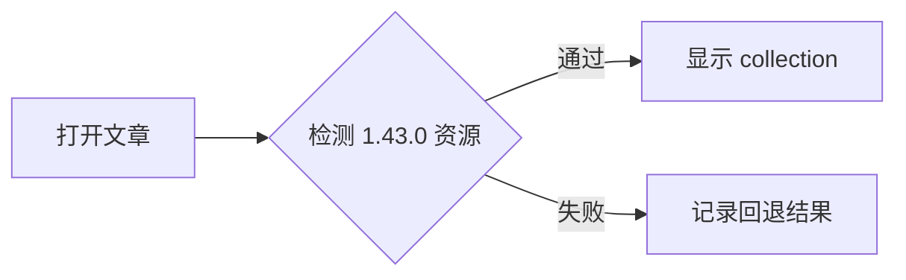

# 这是一篇 1.43.0 验收文章

这篇文章用于检查 Stellar 1.43.0 的文章详情页、目录、正文间距、代码高亮和首页热门文章集合。刷新首页后，它也应以一条紧凑的 `list/nav` collection 项目出现。

## 公式渲染

行内公式：$E = mc^2$。下面是显示公式：

$$
\int_{-\infty}^{\infty} e^{-x^2}\,dx = \sqrt{\pi}
$$

如果页面加载完成后公式仍是原始定界符，请检查按需加载的 KaTeX 资源和深色主题样式。

## Mermaid 图表



<div class="mermaid">
flowchart TD
  Home[首页] --> Collection[热门文章 collection]
  Collection --> Article[1.43.0 验收文章]
  Article --> Math[数学公式]
  Article --> Diagram[Mermaid 图表]
</div>

## 代码高亮与表格

```go
func collectionReady(layout, variant string) bool {
    return layout == "list" && variant == "nav"
}
```

| 验收项 | 期望结果 |
| --- | --- |
| 首页热门文章 | `ui-collection` / `list` / `nav` / `compact` |
| 文章详情页 | 标题、目录、正文和代码块正常显示 |
| 数学公式 | 行内与块级公式按需渲染 |
| Mermaid | 图表可见，深色主题对比度足够 |

## 验收结论

请在桌面和移动视口分别打开本文，检查窄屏下表格可横向滚动、代码块不撑破页面，以及返回首页后热门文章项目不会回退到旧的 `.item.title` 结构。
