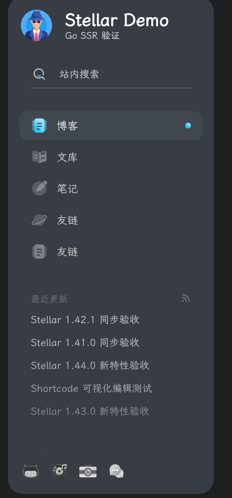

# 左栏 UI 风格（glass / card）核查归档 + Console 提示文案修正

SID: S-20260901-002
日期: 2026-09-01
分支: `codex/leftbar-uistyle-audit`
参照基线: 上游 Stellar 主题源码（`resource/hexo-theme-stellar`，**以主仓库 `/Users/sakurasep/Documents/Code/Project/Blog` 为准，该目录不在本 worktree 内**）

## 1. 背景与用户原始疑问

用户初始疑问：「左侧能改风格吗 / 后端有 UI 控件吗」；澄清后真问题为「侧栏纯色背景好像和源码不同」；最后提出「上游没有这个功能，我们自己加一下」。

**核查结论：上游有此功能（`style.leftbar.ui-style`，glass / card），且本地已完整实现，无需新增。**
用户截图中的纯色背景即上游默认观感（`card` 为上游默认值），不存在偏差。
本次范围收缩为：归档核查证据链 + 修正一处错误提示文案。

## 2. 结论一：`@image` 没有 `#1:` 风格维度 → N/A

| 来源 | 路径 | 事实 |
| --- | --- | --- |
| 上游 tag 插件 | `resource/hexo-theme-stellar/scripts/tags/lib/image.js:5,11` | 声明 `[width,height,bg,download,padding,fancybox,ratio]` + 位置参数 `src/alt`，无 `type`/`style`/`#n` |
| 上游 CSS | `resource/hexo-theme-stellar/source/css/_components/tag-plugins/image.styl` | 仅一种布局（`.image-bg/.image-meta/.image-caption/.image-download`） |
| Go 渲染器 | `internal/post/shortcode_media.go:71-144` | 与上游逐项对齐，同样无 style 参数 |
| 短码 catalog | `internal/post/shortcode_catalog.go:293-299` | 仅 9 个字段（src/alt/width/height/bg/download/padding/fancybox/ratio）；面板由 `PluginParamForm` 元数据驱动，无 `style` 字段即无控件 |
| Console 前端 | `modules/console/web/src/**` | 零命中 |

→ 这是审计的 **N/A 项**，不是缺口。

## 3. 结论二：左栏 glass/card 风格切换 —— 上游有，本地已全量实现

### 3.1 上游证据（此前误判为「上游没有」）

| 证据 | 路径（主仓库） | 内容 |
| --- | --- | --- |
| 设计 spec | `resource/hexo-theme-stellar/docs/designs/2026-08-12-leftbar-card-style/spec.md` | status **已通过**；配置 `style.leftbar.ui-style`，取值 `glass`/`card`，**默认 `card`** |
| 知识库 | `resource/hexo-theme-stellar/docs/knowledge/02-布局系统/sidebar-system.md:402` | 「该配置项默认值为 `card`」 |
| 上游模板 | `resource/hexo-theme-stellar/layout/layout.ejs:53` | `` `<aside class="l_left${leftbarSurface === 'card' ? ' leftbar-card' : ''}" data-ui-surface="${leftbarSurface}">` `` |
| 上游样式 | `resource/hexo-theme-stellar/source/css/_components/sidebar/sidebar.styl:19-40` | `.l_left.leftbar-card { background: var(--card); box-shadow: $boxshadow-float; --leftbar-item-bg/-shadow/-search-line; --bg-a20/50/60/75: var(--block); --bg-a100: var(--block-border); .sidebg{display:none}; :before/:after{display:none} }` |

### 3.2 本地四层对照（已全部接通）

| 层 | 路径（本仓库） | 状态 |
| --- | --- | --- |
| Console 控件 | `modules/console/web/src/modules/settings/AppearanceTab.vue:238-241` | ✅ select，选项 `纯色模式(card)` / `光晕模式（背景图毛玻璃）(glass)` |
| Go 配置模型 | `internal/settings/model_style.go:206` | ✅ `UIStyle string \`yaml:"ui-style" json:"ui_style"\`` |
| 模板桥接 | `modules/stellar/web/templates/layout/base.html:19-21` | ✅ `leftbar-card` 条件类 + `data-ui-surface`，对齐 layout.ejs:53 |
| 编译 CSS - card | `modules/stellar/web/assets/css/main.css:8663`（含 `:8675` `.sidebg{display:none}`、`:8678-8679` `:before/:after` 隐藏） | ✅ 与上游 stylus 一致 |
| 编译 CSS - glass | `main.css:8698` 内置占位图 `placeholder@1.0.13/image/sidebar-bg1@small.jpg`；`:8741+` `@media (min-width:667px)` 磨砂高光 | ✅ |

### 3.3 切换路径

Console → 设置 → 外观 → 左侧栏背景 → 「左侧栏样式」：
`纯色模式`（card，默认）⇄ `光晕模式（背景图毛玻璃）`（glass）。

## 4. 错误更正记录（grep 转义假阴性事件）

此前审计时用 `grep "l_left\|leftbar-card\|sidebg"` 得到 0 命中，据此写下「侧栏样式块在编译产物中完全缺失」的结论。
**该结论错误** —— 双引号内的 `\|` 被 shell/工具吞掉转义后变成字面匹配，导致假阴性。
改用 `grep -cE "l_left|leftbar-card|sidebg"` 实际命中 **33 行**（含 `main.css:8663-8700` 的完整 card/glass 样式块）。

教训：正则交替一律用 `grep -E` + 未转义 `|`；得到 0 命中的「缺失」结论前，必须换一种写法复核（如 `grep -F` 固定串或缩小到单个词 `grep -c leftbar-card`）。

## 5. 唯一真实缺陷：Console 提示文案与实现不符（本次已修正）

`modules/console/web/src/modules/settings/AppearanceTab.vue:242-244` 原文案：

> 光晕模式需配置下方「背景图片 URL」才有效果，未配置时前台仍呈现纯色卡片。

**错误**：`main.css:8698` 已内置 `sidebar-bg1@small.jpg` 占位背景图，glass 模式即使不配 `background_image` 也正常生效，不会退化成纯色卡片。该文案会劝退用户切换到 glass。

已改为：

> 未配置背景图片时使用主题内置默认背景图；配置后将替换为自定义图片。

`v-if` 条件保持不变，仅替换文案。

## 6. 浏览器验收记录（2026-09-01 实测通过）

验收环境：独立端口 `:8091` 起 dev 服务（`BLOG_LISTEN`，独立数据库 + seed），Console 前端重建后重启服务再验收（Playwright 1440x900，非 HTTP 200 证据，含 computed style 断言）。

| 验收项 | 预期 | 断言结果 | 截图 |
| --- | --- | --- | --- |
| card（默认） | 侧栏实心 `var(--card)` 背景 + 中间档阴影，`.sidebg`/`::before/::after` 隐藏 | PASS：`leftbar-card` 类 + `data-ui-surface="card"`、`display:none` 三项、背景 `rgb(55,61,67)`、阴影 `rgba(0,0,0,0.05) 0 4px 8px`（= 上游 `$boxshadow-float`） | `card-1440x900.png` |
| glass（不配 `background_image`） | **内置占位背景图正常显示**（修正文案所依据的事实） | PASS：`data-ui-surface="glass"`、`.sidebg` 显示，`background-image` = 内置占位图 `sidebar-bg1@small.jpg`，`filter: saturate(4) blur(100px) opacity(0.6)`（深色覆盖档） | `glass-default-1440x900.png` |
| glass + 配 `background_image` | 自定义图替换占位图 | PASS：`background-image` 变为自定义 `rainbow64@3x.webp`，占位图 URL 不再出现 | `glass-custom-1440x900.png` |
| 恢复 card 闭环 | 切回 card 后回归默认态 | PASS：`leftbar-card` 回归、`.sidebg` 隐藏 | — |

Console 侧佐证：切换到 glass 时提示文案显示为修正后文案（「未配置背景图片时使用主题内置默认背景图；配置后将替换为自定义图片。」），见 `console-glass-hint.png`。
验收后已将设置恢复为默认（card、无自定义背景图）。

## 7. 遗留项（本次不做，记录备查）

`internal/settings/model_style.go:392-408` `leftbarCSS()` 从不读取 `UIStyle`，且 `BackgroundColorDark` 写入内层 `.l_left .leftbar-container` 而非外层 `.l_left.leftbar-card`。
实测 `.leftbar-container` 为 `height: calc(100vh - gap*2)` + `border-radius: 24px`，尺寸与外层一致，故纯色下视觉无「双重背景」问题，属**低优先级**而非 bug。
若未来做 UIStyle 与背景覆盖联动，需一并处理该写入层级。
